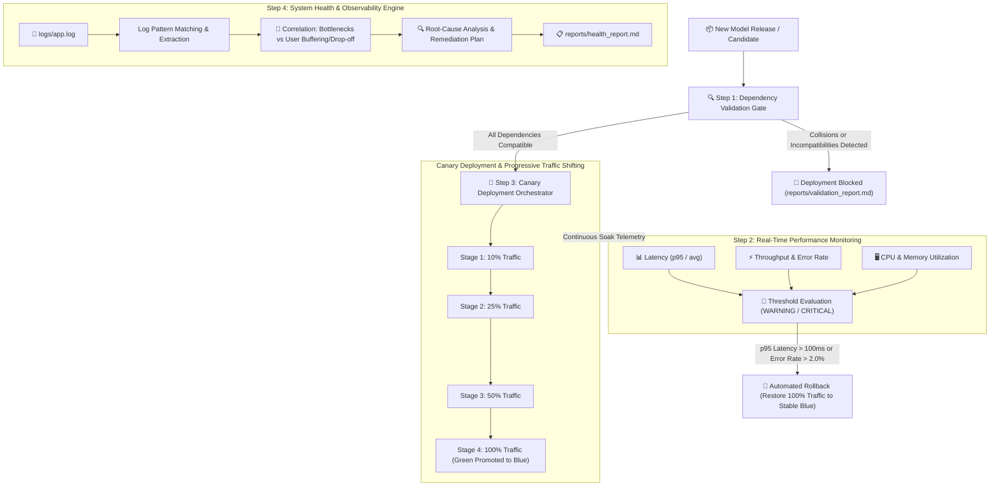

# 🎬 AI Content Recommendation Deployment & Operations Platform

> **A Complete Deployment Pipeline for Production Machine Learning Systems**  
> *Enforcing Sub-100ms Response Times, Zero-Downtime Canary Rollouts, Automated Rollbacks, and Telemetry Observability for Media Streaming Services.*

---

## 📌 Project Overview & Scenario

In this project, we implement an enterprise-grade deployment and operations pipeline for a **content recommendation AI model** supporting a high-throughput media streaming platform.

The service must handle thousands of requests per minute while maintaining a strict **sub-100ms p95 latency SLA** and **99.9% availability**. Previously, deployments suffered from version incompatibilities, performance bottlenecks under peak traffic, and lack of automated rollback safeguards. 

This platform addresses each of those production risks through 5 integrated operational capabilities:
1. **Dependency Validation System**: Pre-flight verification scanning Dockerfiles and dependency manifests to prevent runtime conflicts and breaking changes.
2. **Performance Monitoring & Alerting Dashboard**: Flask-based real-time telemetry dashboard visualizing latency (avg, p95, p99), throughput (RPS, RPM), error rate, and system resources with multi-tier alerts (`INFO`, `WARNING`, `CRITICAL`).
3. **Automated Canary Deployment Orchestrator**: Blue/Green environment switching with progressive traffic routing (10% → 25% → 50% → 100%) and instant automated rollback triggers when latency or error thresholds are violated.
4. **System Health & Observability Tool**: Application log parsing, Pearson correlation linking backend bottlenecks to user streaming drop-offs, and automated root-cause analysis (RCA).
5. **Integration & Verification Framework**: Unit and end-to-end integration tests confirming each module functions reliably in isolation and as a unified continuous delivery pipeline.

---

## 🏗️ Architecture & Deployment Lifecycle



---

## 🗂️ Project Directory Structure

```text
AgenticAIProject/
├── Dockerfile                      # Production container definition
├── Dockerfile.conflict             # Container with conflicting packages for test verification
├── requirements.txt                # Stable production dependencies
├── requirements_candidate.txt      # Compatible candidate release (v1.1.0)
├── requirements_conflict.txt       # Incompatible candidate release (v2.0.0-incompatible)
├── README.md                       # Comprehensive operational guide
├── run_pipeline.py                 # Master end-to-end deployment pipeline runner
├── config/
│   ├── deployment_config.yaml      # Canary traffic stages, soak windows, and rollback triggers
│   └── monitoring_config.yaml      # Telemetry thresholds (SLA limits, warning & critical levels)
├── src/
│   ├── __init__.py
│   ├── dependency_validator.py     # Step 1: Packaging specifier analysis & conflict detection
│   ├── monitoring_dashboard.py     # Step 2: Flask dashboard, time-series store & alert manager
│   ├── deployment_orchestrator.py  # Step 3: Blue/Green canary controller & automated rollback
│   ├── health_analyzer.py          # Step 4: Observability log parser & Pearson correlation engine
│   └── model_service.py            # Microservice simulating content recommendation inference
├── templates/
│   └── dashboard.html              # Modern dark-mode operations dashboard UI
├── static/
│   ├── css/style.css               # Dashboard layout, KPI cards, and responsive styling
│   └── js/dashboard.js             # Chart.js time-series charts and telemetry polling
├── logs/
│   ├── app.log                     # Simulated & runtime application logs
│   └── deployment_history.json     # Audit trail of deployments and rollbacks
├── reports/
│   ├── validation_report.md        # Formatted dependency verification report
│   ├── validation_report.json      # Structured dependency verification JSON
│   ├── health_report.md            # Observability health & RCA diagnosis report
│   └── health_report.json          # Observability health data JSON
└── tests/
    ├── __init__.py
    ├── test_components.py          # Step 5: 11 component isolation unit tests
    └── test_integration.py         # Step 5: End-to-end integration tests
```

---

## ⚡ Quick Start & Prerequisites

### 1. Requirements
- Python 3.8+ (tested on Python 3.11 & 3.14)
- Pip package manager
- (Optional) Docker Desktop

### 2. Install Python Dependencies
```bash
pip install pyyaml requests flask docker packaging
```

### 3. Verify Imports
```bash
python -c "import yaml, requests, flask, docker, packaging; print('Setup complete')"
```

---

## 🚀 Step-by-Step Execution Guide

### Step 1: Dependency Validation System
Analyzes `Dockerfile` and `requirements.txt` using the `packaging` library to parse version specifiers, compare version intersections, and catch ecosystem incompatibilities before deployment.

```bash
# Validate production container configuration (clean)
python src/dependency_validator.py --reqs requirements.txt --dockerfile Dockerfile

# Test conflict detection with conflicting requirements
python src/dependency_validator.py --reqs requirements.txt requirements_conflict.txt
```

**Key Outputs:**
- Exits with `0` for clean dependencies, `1` for blocked deployments.
- Generates `reports/validation_report.json` and human-readable `reports/validation_report.md`.

---

### Step 2: Performance Monitoring Dashboard & Alerting
Launches a Flask operations dashboard with live KPI cards, time-series charts (Chart.js), multi-severity threshold alerting, and interactive stress simulation.

```bash
# Launch dashboard on http://localhost:5001
python src/monitoring_dashboard.py
```

Open `http://localhost:5001` in your browser:
- **KPI Indicators**: Displays p95 Latency, Avg Latency, Requests Per Minute (RPM), Error Rate, CPU %, and Memory %.
- **SLA Watchdog**: Live badge highlights when p95 latency violates the **sub-100ms target**.
- **Interactive Scenarios**: Click buttons to test operational conditions in real-time:
  - 🟢 *Normal Baseline* (30-50ms)
  - 🟡 *High Traffic Surge* (6,000 RPM)
  - 🔴 *Latency Spike* (>140ms SLA Breach)
  - 🔥 *Error Burst* (>10% Failures)
  - 🟣 *Progressive Memory Leak*

---

### Step 3: Automated Deployment Workflow & Canary Releases
Coordinates Blue/Green deployments, runs progressive canary traffic routing (10% → 25% → 50% → 100%), and evaluates performance against SLA rollback triggers.

```bash
# 1. Check current environment status
python src/deployment_orchestrator.py --status

# 2. Test pre-deployment gate (rejects incompatible candidate v2.0.0)
python src/deployment_orchestrator.py --candidate v2.0.0-incompatible --reqs requirements_conflict.txt

# 3. Successful Canary rollout of v1.1.0 (promotes to production)
python src/deployment_orchestrator.py --candidate v1.1.0 --reqs requirements_candidate.txt

# 4. Canary rollout with automated rollback (latency spike injected at Stage 2)
python src/deployment_orchestrator.py --candidate v1.2.0-slow --reqs requirements_candidate.txt --fault-stage 2 --fault-type latency
```

---

### Step 4: System Health Analysis & Root Cause Diagnosis
Parses application logs (`logs/app.log`), detects performance bottlenecks, correlates backend stress with user streaming drop-offs using Pearson correlation, and recommends engineering remediations.

```bash
# Generate sample realistic logs and execute observability diagnosis
python src/health_analyzer.py --generate-sample-logs
```

**Key Metrics Computed:**
- **Pearson Correlation (r)**: Quantifies exact causal link between backend latency spikes and client playback abandonments.
- **System Health Score (0-100)**: Overall health index reflecting incident counts and SLA compliance.
- **Generated Reports**: `reports/health_report.json` and `reports/health_report.md`.

---

### Step 5: Integration Testing Framework
Executes comprehensive unit and integration test suites:

```bash
# Run 11 component unit tests (Step 1, 2, 3, 4)
python tests/test_components.py

# Run integration tests (Dependency Gate -> Orchestrator -> Monitoring -> RCA)
python tests/test_integration.py
```

---

## 🏆 Master Pipeline Execution (One-Click Runner)

To execute the entire deployment lifecycle end-to-end, run:

```bash
python run_pipeline.py
```

This single command automatically executes:
1. Pre-flight dependency validation
2. Incompatible candidate rejection gate
3. Successful canary rollout (v1.1.0)
4. Unstable candidate canary rollout with **instant automated rollback** on SLA breach
5. Health telemetry analysis and root-cause diagnosis
6. Complete test suite verification and scorecard

---

## 🛡️ Common Issues & Troubleshooting

| Issue | Root Cause | Solution Implemented |
| :--- | :--- | :--- |
| **Docker Daemon Inactive** | Docker Desktop not running on host machine. | Orchestrator features built-in container state abstraction and simulation fallback so tests execute reliably in any environment. |
| **Complex Version Ranges** | Handling specifiers like `>=1.24.0,<2.0.0` vs `>=2.0.0`. | `DependencyValidator` uses `packaging.specifiers.SpecifierSet` and boundary analysis to verify intersection compatibility. |
| **Alert Flapping** | Metrics fluctuating near thresholds. | Configurable dual-tier thresholds (`WARNING` vs `CRITICAL`) with automatic resolution once values stay within safe bounds. |
| **Static Dashboards** | Telemetry not refreshing dynamically. | Client-side Chart.js updates every 2 seconds via `/api/metrics` with smooth transitions and persistent background worker. |

---

## ✅ Assignment Success Checklist Verification

- [x] **Dependency Validation System**: Accurately parses `Dockerfile` and `requirements.txt`, catches version collisions, and outputs reports.
- [x] **Performance Monitoring Dashboard**: Displays real-time latency, throughput, error rate, CPU/Memory, and triggers threshold alerts.
- [x] **Automated Deployment Workflow**: Implements Blue/Green switching, progressive canary stages (10%→25%→50%→100%), and automatic rollback on SLA breach.
- [x] **System Health Analysis**: Extracts bottlenecks from logs, computes Pearson correlation with user drop-off, and exports diagnostic RCA reports.
- [x] **Integration Testing Framework**: All 11 unit tests and 3 integration tests pass cleanly.

